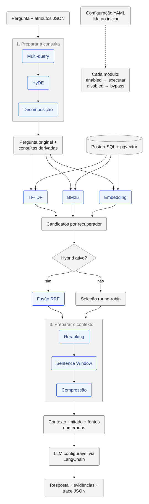

# Arquitetura e contratos



[Abrir SVG](diagrams/rag-pipeline.svg) · [Editar fonte Mermaid](rag-pipeline.mmd)

## Dois fluxos

**Preparação:** arquivos → sentenças/unidades → embeddings opcionais → PostgreSQL.
LangChain divide sentenças muito longas; posições sequenciais permitem recuperar
vizinhos. Cada documento é substituído em uma transação, evitando duplicação em uma
reingestão. Uma falha na geração de embeddings preserva a versão anterior do documento.

**Consulta:** pergunta → Multi-query → HyDE → Decomposição → TF-IDF → BM25 → Embedding
→ Hybrid → Reranking → Sentence Window → Compressão → contexto → LLM → resposta/fontes.

TF-IDF, BM25 e Embedding são ramos de recuperação independentes: alimentam o mapa
`retrieval`, sem consumir os resultados uns dos outros. Hybrid combina seus rankings
por RRF. Sem Hybrid, a seleção básica intercala os rankings; não calcula score híbrido.
As etapas de preparação acumulam consultas sem substituir a pergunta original.
HyDE produz uma representação sintética usada exclusivamente pelo recuperador vetorial.

Os módulos são componentes Python no mesmo processo. A fronteira é JSON, permitindo
futura extração para serviços, mas esta versão não exige dez containers nem uma fila.
O orquestrador faz um round-trip JSON e valida o envelope após cada módulo ativo.

## Envelope acumulativo

```json
{
  "schema_version": "1.0",
  "request_id": "uuid",
  "question": "O que é busca híbrida?",
  "queries": ["O que é busca híbrida?"],
  "retrieval": {},
  "evidence": [],
  "context": "",
  "answer": null,
  "attributes": {"grupo": "G7", "experimento": "rrf-60"},
  "trace": []
}
```

Campos desconhecidos são preservados pelo contrato; prefira `attributes.<nome_da_missao>`
para resultados adicionais. Um módulo deve receber e devolver o envelope inteiro,
preservar a pergunta original e os atributos que não lhe pertencem. Conexões, clientes
de SDK e objetos de modelo ficam em `Services`, fora do JSON.

`queries`, `retrieval`, `evidence`, `context`, `answer`, `trace` e `attributes.hyde`
são controlados pela execução e reiniciados no início de cada consulta. Não podem
ser usados para injetar fontes por `POST /query`. Metadados de experimentos e demais
atributos extras permanecem disponíveis aos módulos.

Cada evidência carrega `id`, `document_id`, `source`, `position`, `text`, `metadata`,
`score`, `scores`, `context_text` e `citation`. O texto original não é sobrescrito;
expansão/compressão alteram `context_text`. O orçamento de contexto é em caracteres,
não tokens. A lista final `evidence` contém somente os trechos enviados ao LLM, com
numeração correspondente ao contexto. Os candidatos anteriores continuam em `retrieval`.

## Ativação e bypass

Os dez switches são obrigatórios no YAML. Nomes desconhecidos e tipos incorretos são
rejeitados. O arquivo é lido na inicialização da CLI ou no lifespan da API e permanece
estável durante aquela execução. Não existe recarga por request; reinicie a API após
editar a configuração.

Um módulo desligado não é instanciado nem chamado. Seu registro no `trace` tem
`status: bypass`. O fluxo segue para a próxima etapa. Erros de módulos ativos encerram
a consulta; não são convertidos em bypass, para não esconder falhas nos experimentos.

Se todos os recuperadores estiverem desligados ou nenhum candidato for encontrado,
o sistema devolve uma resposta de ausência de evidência sem chamar a geração final.
Módulos de preparação ativos ainda podem chamar o LLM antes dessa constatação.

## Fronteiras de infraestrutura

`PostgresStore` concentra SQL parametrizado. `Providers` adapta chat e embeddings
por meio de LangChain. O pgvector armazena vetores sem dimensão fixa na coluna para
permitir modelos de dimensões distintas, mas a chave de configuração impede misturar
essas representações numa consulta. Dimensões reais e valores finitos/não nulos são
validados antes de persistir ou pesquisar.

A chave considera fornecedor, endpoint, modelo e dimensão. Ela não detecta uma troca
dos pesos sob o mesmo nome: registre versão/digest dos modelos em cada experimento.
A API não oferece ingestão por caminho de arquivo; a CLI controla essa operação local.
A versão inicial não mantém caches nem coleções separadas.
