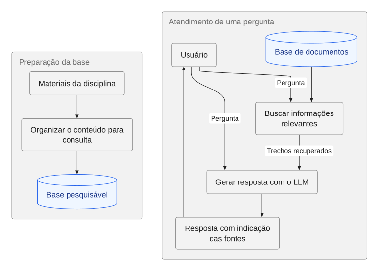
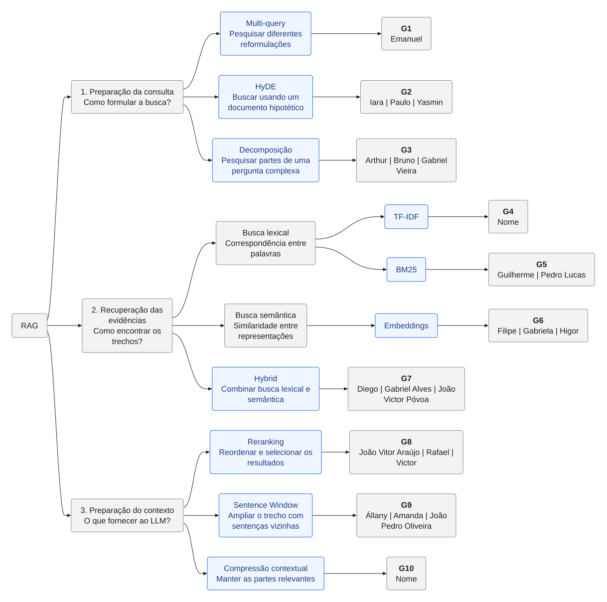
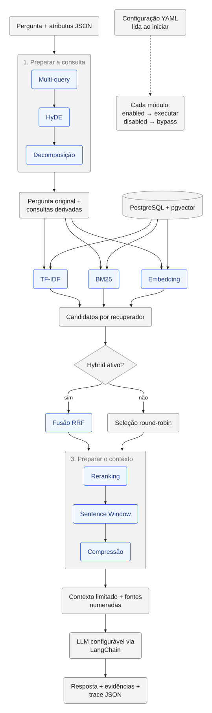

# Diagramas com Pele.js

Todos os diagramas Mermaid da documentação devem ser renderizados por
[Pele.js](https://pele.run/api) e exibidos nos arquivos Markdown como imagens SVG
versionadas. A geração usa `render()` em Node.js; a visualização no GitHub não depende
de JavaScript, plugins ou do renderizador Mermaid do próprio GitHub.

As fontes editáveis ficam em `docs/**/*.mmd`; os SVGs correspondentes ficam em
`docs/diagrams/`, preservando os subdiretórios. Não edite os SVGs manualmente e não
use blocos Markdown `mermaid` como apresentação final dos diagramas.

## Atualizar

Somente para editar os diagramas, instale Node.js 20 ou superior e execute na raiz:

```sh
npm ci
npm run docs:diagrams
npm run docs:check
```

A versão do Pele está fixada em `package.json` e `package-lock.json`. O script encontra
todos os `.mmd` em `docs/`, renderiza com Pele e escreve SVGs determinísticos. `--check`
apenas compara os arquivos gerados e falha se estiverem ausentes ou desatualizados;
a CI executa essa verificação. Node.js não é requisito de execução do sistema RAG.

A exportação fixa as cores do tema claro nos SVGs e acrescenta fundo branco, para
leitura consistente também em visualizadores que não suportam variáveis CSS.

Ao adicionar um diagrama, crie a fonte `.mmd`, execute a geração e inclua a imagem no
documento que o explica, por exemplo ``. Para
novas páginas, confira também o SVG em um navegador antes de entregar.

## Fluxo didático



[Fonte Mermaid](rag-didatico.mmd) · [SVG](diagrams/rag-didatico.svg)

## Técnicas e grupos



[Fonte Mermaid](rag-modulos.mmd) · [SVG](diagrams/rag-modulos.svg)

## Pipeline implementado



[Fonte Mermaid](rag-pipeline.mmd) · [SVG](diagrams/rag-pipeline.svg)
