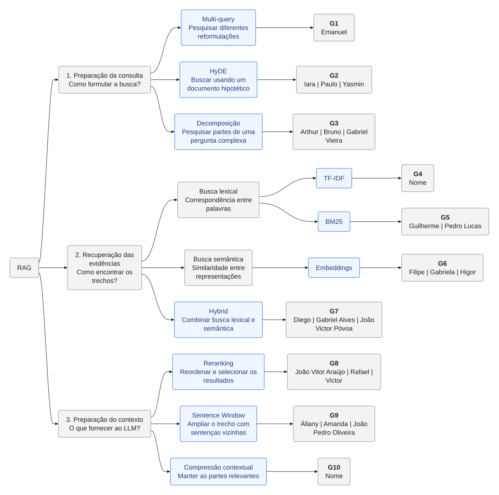

# Missões e protocolo experimental

Os grupos seguem a distribuição de [rag-modulos.mmd](rag-modulos.mmd). O arquivo de
cada missão já contém uma implementação de referência executável.



[Abrir SVG em tamanho completo](diagrams/rag-modulos.svg) · [Editar fonte Mermaid](rag-modulos.mmd)

| Grupo | Técnica | Arquivo em `src/rag_lab/modules/` | Missão inicial |
|---|---|---|---|
| G1 | Multi-query | `multi_query.py` | Medir ganho e redundância das reformulações |
| G2 | HyDE | `hyde.py` | Comparar pergunta direta com documento hipotético |
| G3 | Decomposição | `decomposicao.py` | Investigar cobertura em perguntas compostas |
| G4 | TF-IDF | `tfidf.py` | Avaliar tokenização, stopwords e n-gramas |
| G5 | BM25 | `bm25.py` | Comparar parâmetros e variantes de IDF |
| G6 | Embedding | `embedding.py` | Comparar modelos, dimensão e custo de recuperação |
| G7 | Hybrid | `hybrid.py` | Comparar round-robin e RRF variando `rrf_k` |
| G8 | Reranking | `reranking.py` | Substituir sobreposição lexical por um cross-encoder |
| G9 | Sentence Window | `sentence.py` | Melhorar segmentação e variar o raio de vizinhança |
| G10 | Compressão | `compressao.py` | Comparar extração lexical com compressão por modelo |

## Contrato de entrega

Implemente `run(payload: dict, services: Services) -> dict`. Preserve os atributos
existentes e acrescente os resultados no campo da técnica. Use o YAML para parâmetros
compartilhados e acrescente sua validação em `config.py` se criar novas opções. Não
coloque credenciais, conexões ou objetos não serializáveis no envelope.

Um módulo ativo deve executar sua estratégia; se ela não puder executar, a falha deve
ficar visível. Não transforme uma implementação incompleta em bypass silencioso.
O bypass é responsabilidade do orquestrador e depende apenas do switch carregado.

## Comparação controlada

1. Defina uma base pequena, com autorização para uso em aula, e um conjunto fixo de
   perguntas. Inclua consultas literais, semânticas, compostas e sem resposta na base.
2. Para cada pergunta, anote quais documentos/trechos são relevantes e o que uma
   resposta sustentada deve conter. Não use a saída do próprio sistema como gabarito.
3. Execute a configuração básica com apenas um recuperador ativo. Salve o envelope
   JSON em `data/results/`, junto do YAML usado, versão do código, modelos/digests,
   hardware, data e critérios de avaliação. Não compartilhe segredos do `.env`.
4. Ative ou altere uma técnica por vez. Mantenha corpus, perguntas, modelos e orçamento
   de contexto constantes, exceto quando a própria missão investigar esse parâmetro.
5. Compare recall@k dos trechos relevantes, posição do primeiro resultado relevante,
   fidelidade da resposta às fontes, citações corretas, latência e chamadas aos modelos.
   Distingua métricas por documento das métricas por trecho. Para Multi-query/HyDE,
   considere também o custo e o tempo de preparação da consulta.
6. Faça ablação: desligue o módulo e confira o `bypass` no trace. Repita consultas para
   avaliar variabilidade do LLM e registre casos em que a técnica piorou o resultado.

Exemplo de coleta local:

```sh
mkdir -p data/results
uv run rag-lab --config config/lab.local.yaml query "Como funciona RAG?" > data/results/baseline.json
```

O laboratório fornece evidências e tempos para inspeção; esta versão não automatiza
julgamento de qualidade nem calcula métricas a partir de gabaritos. Apresente a tabela
comparativa, casos concretos, limitações e uma justificativa para manter ou rejeitar a
estratégia. Evite concluir que uma técnica melhora o sistema com base em uma única
resposta aparentemente boa.
